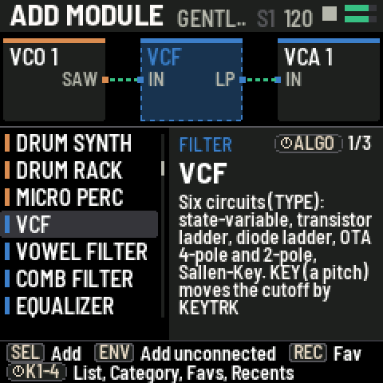
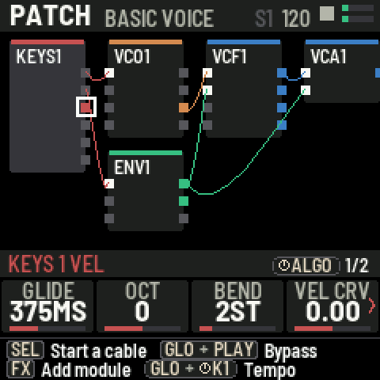
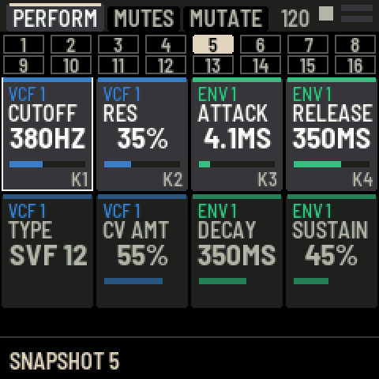
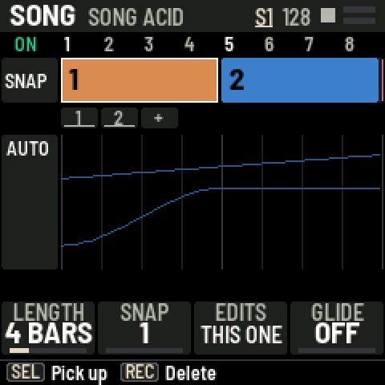

# PATCHWERK

A patchable modular synthesizer for the M-VAVE FM-1: firmware for the unit, plus a browser emulator with a visual patch bay.

**[Try it in your browser](https://mattkuebrich.github.io/patchwerk/)**: the same firmware, the FM-1 drawn on screen. Turn on sound and play.
Connect a real FM-1 over USB (desktop Chrome or Edge) and the page and the unit stay in sync both ways.

## What it is

- **Over 80 modules** joined by virtual cables on the FM-1's own screen and knobs: oscillators, a Casio CZ and a TX81Z-style FM voice,
  six filter circuits, drums, a sampler and granular player, step, Euclid, Turing and piano-roll sequencers, effects, envelopes and LFOs.
- **Snapshots and performance:** 16 snapshots per patch, a PERFORM page for your favorite knobs, MUTES, MUTATE, and a SONG mode that
  arranges snapshots and automates knobs.
- **Sound in and out:** MIDI over USB and TRS, USB audio both ways, four sample banks (A to D) loaded from the web page or recorded on the unit.
- **Screen colors:** twelve palettes and a USER palette you design on the page.

## Install on an FM-1

Open the [page](https://mattkuebrich.github.io/patchwerk/) in desktop Chrome or Edge, connect the FM-1 with a USB data cable, back up
your projects and samples, and press **Install**. The same page puts M-VAVE's own firmware back. You can also download
`patchwerk.fwsc` from the [Releases](https://github.com/MattKuebrich/patchwerk/releases) and choose it on the page.

Unofficial: not made or endorsed by M-VAVE. Installing firmware is at your own risk; BUILDING.md has the rescue steps.

## Using it

HOME is the patch screen. **FX** adds a module, **SELECT** and **SEL** patch cables, the four knobs shape the selected module and
**ALGO** turns its pages. A button pressed again turns to its next page. **ENV** is PERFORM (again: MUTES, MUTATE), **SEQ** the
sequencers, **SAVE** the save page and the menu. The unit's HELP page (press SAVE until you reach it) lists every shortcut;
the [cheatsheet](https://mattkuebrich.github.io/patchwerk/cheatsheet.html) has them on one page, and [docs/REFERENCE.md](docs/REFERENCE.md) has every module and setting.

## Build

- [BUILDING.md](BUILDING.md): build the firmware (macOS or Linux; Docker on a Mac), install it, the host simulator and tests.
- [RELEASING.md](RELEASING.md): publish a version to GitHub (`publish.command` does it).
- `CHANGELOG.txt`: what each version changed.

## Credits and license

PATCHWERK is GPL-3.0-only (`LICENSE`). It is built on [fm1-base](https://github.com/charlesvestal/fm1-base) and
[felucca-bsp](https://github.com/hugelton/felucca-bsp) (`base/`), whose files stay MPL-2.0 file by file (`base/LICENSING.md`). The CZ module
is a port of Melodee's CZ engine (GPL-3.0, Kerem Kilic) and MAME's uPD933 model (BSD-3-Clause, Devin Acker). The FM-DX module is a
port of ymfm's OPZ (YM2414) model and tables (BSD-3-Clause, Aaron Giles; `assets/dx/LICENSE-ymfm.txt`).
