# PATCHWERK reference

Every control, setting and module. [`README.md`](../README.md) is the short version. The unit's HELP page and the [cheatsheet](https://mattkuebrich.github.io/patchwerk/cheatsheet.html) list the shortcuts, and [`CHANGELOG.txt`](../CHANGELOG.txt) has the release notes.

- [Basics](#basics)
- [Pages](#pages)
- [Controls](#controls)
- [Snapshots and performing](#snapshots-and-performing)
- [Song](#song)
- [Sequencing](#sequencing)
- [Tempo and metronome](#tempo-and-metronome)
- [Modules](#modules)
- [Sample banks](#sample-banks)
- [Backup](#backup)
- [Settings](#settings)
- [Palettes](#palettes)

## Basics

HOME is the patch: every module is a box, laid out by signal flow, with inputs on the left edge, outputs on the right and every cable drawn.

**Signals.** Audio swings ±5 V, pitch is 1 V per octave (0 V is C4) and gates are 0 or 5 V. Several cables into one input add up. Any output can feed any input.

**Adding a module.** FX opens ADD MODULE at the cursor, with a strip along the top showing where it would go. SELECT browses, KNOB 2 jumps a category, SEL wires the module in at the highlighted jack, ENV adds it unconnected and GLO+EDIT replaces the module under the cursor, keeping the cables it can (each goes to the jack of the same name, else the one in the same place). Where it goes depends on the cursor:
- On a jack with cables, the new module goes into them.
- On an empty output, that output feeds the new module's input.
- On an empty input, the new module's output feeds it.
- With a cable in hand, the new module takes its loose end.

A signal input (IN, L, R) gets the module inserted, and a control input (FREQ, RATE) gets its output added. One undo takes the whole thing back. In the full list, REC marks a favorite (a star, eight at most), KNOB 3 steps through favorites, KNOB 4 through the last six you added and GLO+OP1-OP4 adds favorite 1-4 on the patch screen.

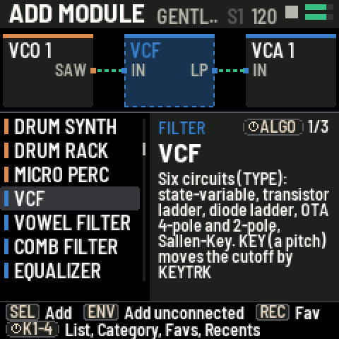

**Patching.** SELECT moves from jack to jack, and turned fast it moves from module to module. SEL grabs a cable at the cursor, SELECT moves to another jack (it stops only where the cable fits) and SEL plugs it in. SEL on an existing connection removes it. GLO+SEL lifts the cable plugged in at the cursor so you can plug it somewhere else. REC unplugs a cable from the jack under the cursor, or drops the cable in hand. Held a moment, REC deletes the module (GLO+OCT- brings it back).

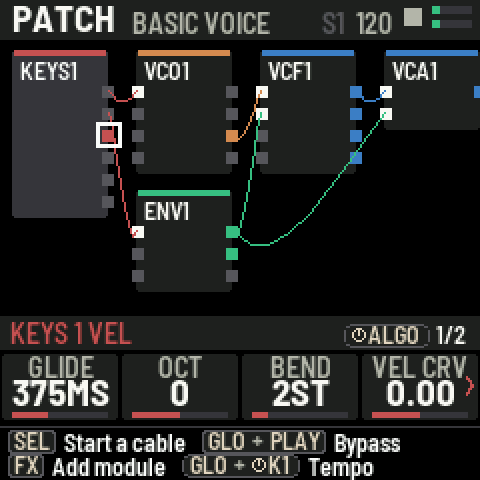

**Shaping.** KNOB 1-4 turn the module's parameters, about 40 detents across a range. Hold GLO for a tenth of that. The page follows the cursor where a jack has its own parameters (a VCF's FREQ jack shows CUTOFF) and ALGO or a tap of HOME turns to the next knob page. EDIT opens the module's own screen: a picture of what it does (an envelope's shape, a filter's curve, the FM algorithm, a drum grid) lit where the current knob page acts.

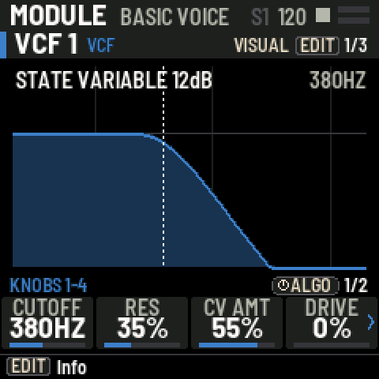

**MATRIX** (ARP). The patch as a list: every module in signal order with its cables under it. Patch, move, delete or bypass modules and cables. On a cable, KNOB 1 sets its depth (-100 to 100 %, so it can attenuate or invert) and it is saved with the patch. Hold SEL to see the place on the patch screen. ARP again goes back.

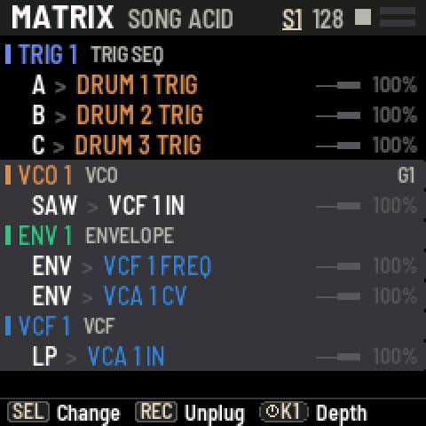

**Groups.** GLO+FX suggests chains going to an output. SELECT turns through them and SEL turns the outlined one into a group, one box you can fold, open and carry between patches. On a group box SEL opens it (HOME leaves), and with a cable in hand the cable goes in with you (plug it into any jack inside and the box gets that jack). GLO+REC ungroups. To keep a group, save a patch with KIND set to GROUP on the SAVE page, and the patch list inserts it into the open patch as one box.

**Safe start.** Hold HOME at power-on to start with a blank patch (an OUTPUT alone) instead of U1, and without the second core. Nothing is deleted.

## Pages

A button pressed again turns to its next page.

| Button | Pressed again |
| --- | --- |
| FX | The add list's pages: what it is, example patch, visualization |
| ENV | PERFORM, then MUTES, then MUTATE. HOME leaves |
| SEQ | The next sequencer |
| EDIT | The module's connections, then its faces |
| SAVE | The menu's pages in turn: SAVE, SETTINGS, HELP, PATCHES |
| ARP, LFO | Goes back (MATRIX and SONG are single pages) |
| ALGO | Turns the pages of any paged screen |
| HOME | On the patch screen, steps the selected module's knob pages |

## Controls

| Control | |
| --- | --- |
| SELECT | The cursor. Jack to jack, or module to module when turned fast (GLO+SELECT: module to module at any speed) |
| KNOB 1-4 | The module's parameters (GLO held: fine) |
| SEL | The thing on screen: grab or plug a cable, add a module in the add list, load a patch in the patch list |
| REC | Unplug a cable. Held: delete the module. Also records (see Sequencing and Song) |
| FX | Add a module at the cursor |
| EDIT | The module's own screen |
| ARP | MATRIX |
| LFO | SONG |
| ENV | PERFORM |
| SEQ | The sequencer's steps on the lower keys |
| PRESETS | The patch list: new, GENERATE PATCH, 50 factory patches, 8 user slots. K2 K3 name a new patch, K4 sets VOICES, K1 the tempo |
| SAVE | The SAVE page, from anywhere (see below) |
| PLAY | The transport. Sequencers, clocks, EUCLID and TURING without a clock cable follow it |
| GLO | The modifier. Held, the knobs move in fine steps and the other buttons take their GLO job. With GLO LATCH on, tap it, then the key |
| keys, OCT- OCT+ | The KEYS module (and ARP): pitch, gate, velocity, pressure. OCT changes the octave |
| HOME | Back to the patch. Held as long as REC takes to delete a module: the CPU and battery in the top bar |

**With GLO**

| Shortcut | |
| --- | --- |
| GLO+OCT- / OCT+ | Undo / redo |
| GLO+ENV, GLO+LFO | Copy the module under the cursor, paste it as a new module |
| GLO+PLAY | Bypass the module (an effect or filter passes its sound, anything else goes quiet). BYP on its box |
| GLO+EDIT | The module runs once per voice, or shared |
| GLO+FX | Group (see Basics) |
| GLO+REC | Ungroup. Held on any other module: delete it and wire its cables through |
| GLO+KNOB 1 | The tempo, on the patch screen |
| GLO+PRESETS | The metronome |
| GLO+SEQ | The patch screen's size (AUTO, COMPACT, FULL). In the piano roll, its view (AUTO, FOLD, KEYS) |
| GLO+HOME | The keys play notes, or are the BUTTON modules' (a patch with BUTTON and no KEYS is always in buttons) |
| GLO+key 1-8 | Save the playing snapshot (see below) |
| GLO+SAVE | Knob edits reach every snapshot that shares the value, or only this one |

**SAVE.** The SAVE page lists the eight user slots (U1-U8). SELECT picks a slot, SEL stores into it, K2 and K3 edit the name and K4 KIND chooses PATCH or GROUP. On the patch list, SEL loads a patch, and a GROUP is inserted into the open patch as one box. PRESETS opens the list, ALGO there goes to the next menu page and HOME closes it.

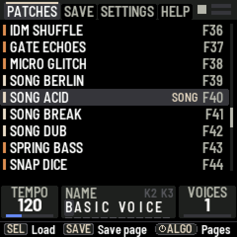

## Snapshots and performing

A patch keeps 16 snapshots. Each holds every knob, every sequencer step and which modules are bypassed, so a snapshot can bring a sound in or take it out. The header shows the one playing (S1). Snapshots you never edited are copies of the patch.

| To | Do |
| --- | --- |
| Save the playing snapshot | GLO + a lower key 1-8, on any screen (hold SEL too for 9-16) |
| Recall one | On PERFORM, a lower key 1-8 (SEL held: 9-16). On the patch screen, SEL + key. Elsewhere, from PERFORM |
| Choose what an edit changes | GLO+SAVE flips between this snapshot only and ALL snapshots that share the value (ALL shows in the header). The EDITS setting sets the default |
| Pick one by voltage | The SNAPSHOT module |
| Pick one by MIDI | Program change 0-15 (the PROGRAM CHANGE setting) |
| Arrange them in time | SONG |

**PERFORM** (ENV) is eight knobs from anywhere. Hold ENV and turn a knob to put it there. SEL held while you move a MIDI controller's knob makes that CC drive the knob (CC 21-28 are the defaults). Its last row, Bar Sync, makes snapshot changes wait for the bar line.

**MUTES** (ENV again) lists the patch's sounds, sequencers and effects, eight tiles a page. A lower key mutes or unmutes one (its module is bypassed, so a muted sequencer stops its notes and tails ring on). SEL held solos it. REC held makes the change wait for the next bar. KNOB 1 is MORPH: every knob moves part way from the snapshot playing (A) to B (GLO + a lower key picks B, otherwise it is the next snapshot). Choosing a snapshot ends it. SEL tapped turns Bar Sync on and off.

**MUTATE** (ENV once more) shakes the patch up and lets you take it back. FX nudges (every knob moves a little) and REC rolls (new values, part way to a random one). KNOB 1 is AMOUNT and KNOB 2 DENSITY, how many knobs are touched. Sequencer steps are included: a roll draws new notes from a pentatonic scale and flips gates. The list shows every module that can be mutated. SEL locks one (it is left alone) and SEL on the top row locks or unlocks all. Locks are saved with the patch. Levels, tuning, banks, presets and tempo are never touched, and resonance and feedback stay below howling. GLO+OCT- undoes a mutation in one step. The MUTATE module does the same from a trigger.

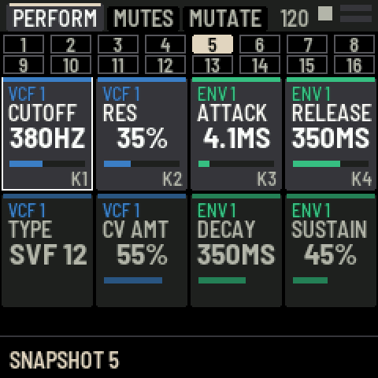

## Song

SONG (LFO) arranges snapshots in time and automates knobs. It is saved with the patch and played by the transport, looping at the end of its last clip or point. LFO again goes back. The header shows S1 underlined while the song is on, and a dot while it records.

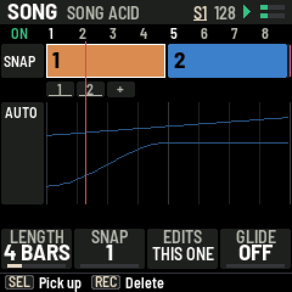

The top lane, SNAP, holds **clips** on a bar grid. ALGO walks down through up to eight automation lanes and a "+" lane for adding one.

| On the SNAP lane | |
| --- | --- |
| SELECT | Moves along the bars. A clip is one stop and a fast turn jumps from edge to edge |
| SEL on an empty bar | A new clip (the length of the last one you set, 4 bars to start) |
| SEL on a clip | Picks it up (SELECT moves it, SEL drops it, REC cancels) |
| REC on a clip | Deletes it |
| GLO+SEL on a clip | Duplicates it, with a snapshot of its own |
| SEL at the start | Turns the song on or off |
| K1 LENGTH | 1-64 bars |
| K2 SNAP | Snapshot 1-16, then the saved patches U1-U8, which load when the clip starts while the beat carries on from the bar |
| K3 EDITS | This one or all snapshots |
| K4 GLIDE | OFF, 1, 2 or 4 bars: how long the knobs take to morph between snapshots |

An **automation lane** moves one knob along the song as a graph of points.

| On an automation lane | |
| --- | --- |
| SEL on an empty spot | Adds a point (or turn K1) |
| SEL on a point | Picks it up (SELECT moves it, SEL drops it) |
| REC on a point | Deletes it |
| GLO+REC | Deletes the lane |
| K1 VALUE | The point's value |
| K2 SHAPE | The segment after it: LINEAR, STEP or SMOOTH |
| K3 ZOOM | 8, 4 or 2 bars |
| K4 KNOB | Points the lane at another knob |

The "+" lane opens a list of every knob of every module (SELECT scrolls and module to module when fast, KNOB 2 jumps module, SEL picks). Or record: REC where there is no point arms recording. Play, then turn knobs on PERFORM or any module page and points are laid on their lanes, thinned out. All lanes share 128 points. The factory SONG patches (SONG BERLIN, SONG ACID and others) show how clips and lanes work together.

## Sequencing

SEQ shows the 16 steps of a SEQUENCER on the lower keys, and again goes to the next module with steps. PLAY starts the transport. A MIDI clock and start/stop also drive it.

**Recording.** REC on the SEQ page cycles STEP REC (each key writes the cursor step and moves on), LIVE REC (with PLAY running, each key writes its note on the nearest step, looping and overdubbing so only the steps you hit change) and off. MONITOR sounds the notes as you record. For TRIG SEQ, GLO+REC on its module page turns on LIVE REC. The first four lower keys are tracks A-D and a hard hit (or GLO held) is an accent. With a clock patched into the sequencer, the step is judged against the transport's sixteenths.

**Random and clear.** On the SEQUENCER and MOD SEQ step pages, GLO+SEL fills the pattern at random and GLO+REC clears it. For the SEQUENCER, random draws notes from a minor pentatonic over two octaves, and ratchets, chances and velocities stay. For MOD SEQ it fills every step of every lane. GLO+OCT- undoes either. On the web page the cards have Randomize and Clear buttons.

**Modulation lanes from knobs.** Hold ARP and turn any knob to put it on a MOD SEQ lane (one is added) with every step at its value. While playing, each step you pass takes the value as you turn. A * marks it, and GLO too lets it go.

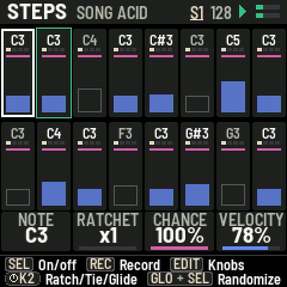

## Tempo and metronome

The tempo is K1 on the patch list and GLO+K1 on the patch screen. The metronome is GLO+PRESETS (turn up for on, down for off) on any page but the patch list. It clicks on each beat (higher on the bar) while the transport plays, and MET in the top bar flashes with it.

## Modules

All 85 modules, with the screen each one draws on the FM-1 (EDIT). The text on the unit's add list is the same.

**Presets.** FM-2, DRUM SYNTH, MODAL PERC, ADDITIVE, MACRO OSC, CZ and FM-DX have a PRESET knob, first on their first page. Turning it sets the module's other knobs to a sound to start from. Only that module changes and one undo takes it back. The same modules (except CZ and FM-DX) and the DRUM RACK also have a PRESET jack that steps through the presets with 0-5 V.

### Sources

| &nbsp;&nbsp;&nbsp;&nbsp;&nbsp;&nbsp;&nbsp;&nbsp;&nbsp;&nbsp;&nbsp;&nbsp;&nbsp;&nbsp;&nbsp;&nbsp;&nbsp;&nbsp;&nbsp;&nbsp;&nbsp;&nbsp;&nbsp;&nbsp;&nbsp;&nbsp;&nbsp;&nbsp;&nbsp;&nbsp;&nbsp;&nbsp;&nbsp;&nbsp;&nbsp;&nbsp;&nbsp;&nbsp;&nbsp;&nbsp;&nbsp;&nbsp;&nbsp;&nbsp;&nbsp;&nbsp;&nbsp;&nbsp;&nbsp;&nbsp; | |
| --- | --- |
| 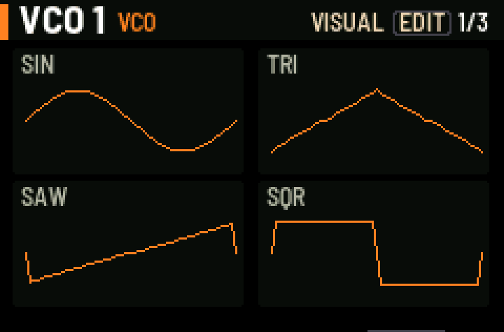 | **VCO** Oscillator with 1 V/oct pitch, sync and pulse width. DRIFT makes the pitch and pulse width wander. ANALOG gives the four waves a scope-style imperfect shape. FM MODE: EXP (1 V/oct), LIN (linear) or TZ (through-zero, so the pitch holds as the modulator swings). |
| 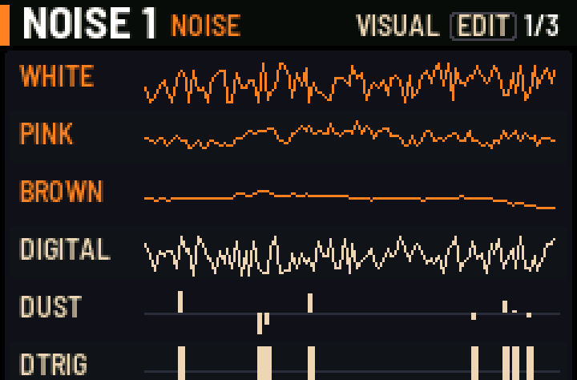 | **NOISE** White, pink, brown and digital noise. TONE darkens or thins it. DUST makes random clicks of random size (DENSITY a second, DTRIG a gate for each). |
| 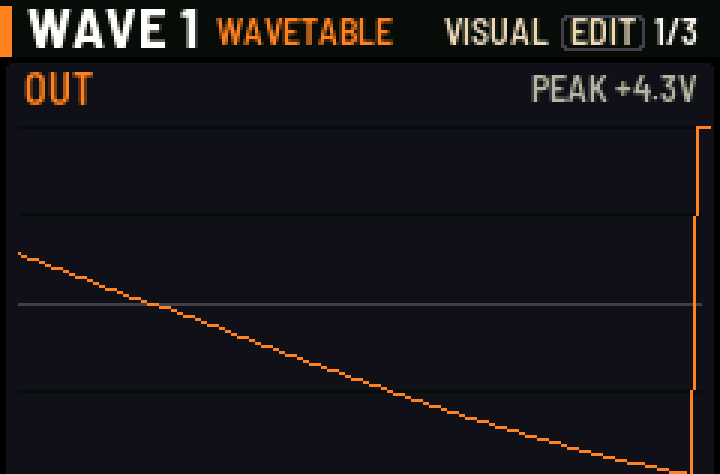 | **WAVETABLE** Digital wavetable oscillator with 4 banks of 8 frames. |
| 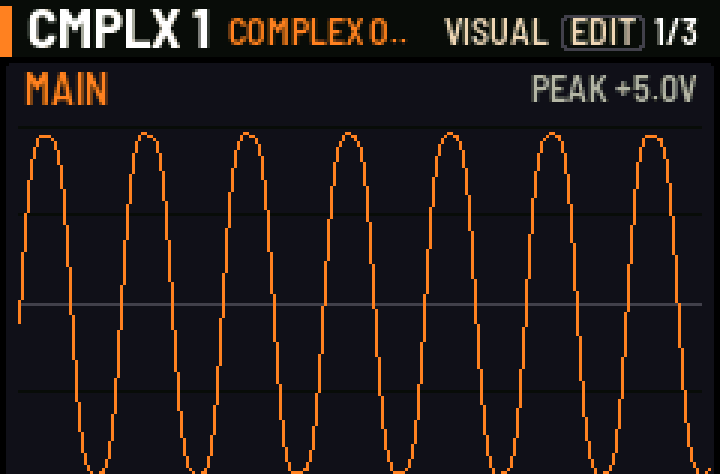 | **COMPLEX OSC** West-coast dual oscillator: an FM pair into a wavefolder. |
| 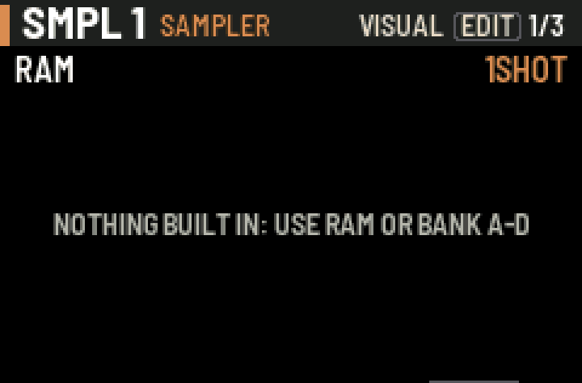 | **SAMPLER** Plays a bank sound or its own recording. Modes: CLASSIC (follows the keys, loops while held, forward or ping-pong), 1SHOT, SLICE (2-16 slices, even or at transients, picked by note or CV) and LOOP. Start, length, REVERSE, WARP (time-stretch), an ADSR, a filter the envelope opens, velocity and glide. BEATS fits a loop to the tempo. BANK picks INTERNAL (its own memory), A, B, C or D and SAMPLE one of the 8 sounds (a SAMPLE input picks it per note). To record, patch AUDIO IN into IN and press REC on its page: arm, record up to a second, stop. STORE keeps that sound with the patch. |
| 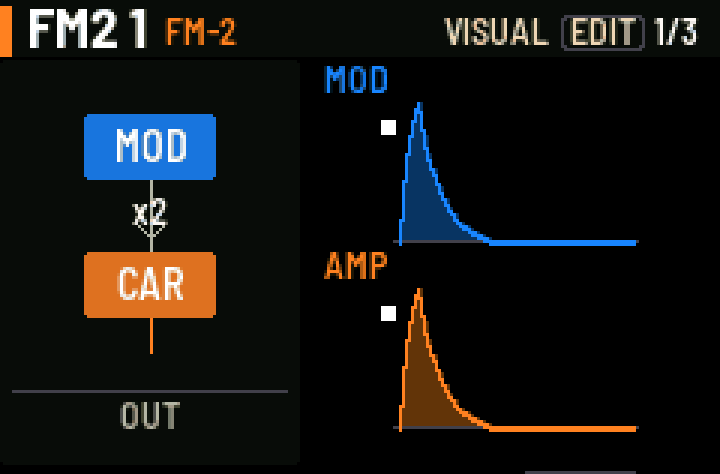 | **FM-2** Two-operator FM voice: a modulator into a carrier. TONE page: PRESET, RATIO (modulator against carrier, 0.25-16), INDEX (how hard it modulates, the INDEX jack adds to it) and FBK (modulator feedback, sine toward saw toward noise). ENVELOPE page: AMP (loudness), MOD (brightness), TIME (0.25-4 times) and TUNE. AMP and MOD pick from twelve shapes: ORGAN, PLUCK, PERC, PIANO, BELL, BRASS, BOW, PAD, SWELL, GATE, BLOOM and TICK. A bell is two long shapes, a pluck a short MOD under a longer AMP. |
| 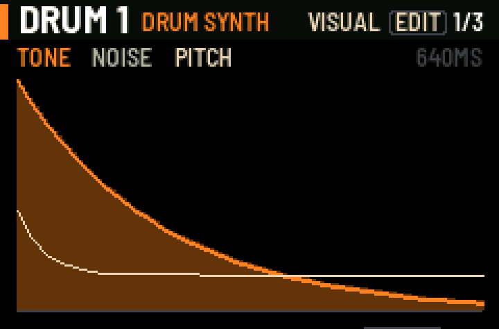 | **DRUM SYNTH** A synthesized drum: swept oscillator, FM, filtered noise and drive. METAL uses squares for cymbals, BURST re-strikes for claps, MODES adds tuned resonances. PRESET has 48 starting sounds. |
| 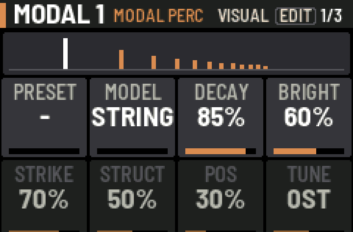 | **MODAL PERC** Struck things that ring: a bank of tuned resonances with a hit on top. MODEL: STRING, BELL, BAR, PLATE, DRUM, TUBE, WOOD, SHEET, SPRING, PIPE, GONG and TIMPANI. STRUCT stretches the spacing of the resonances, POS is where it is struck, STRIKE how hard, BRIGHT how much ring the upper ones keep, EXCITER the hit (NOISE, CLICK or MALLET) and BEND the pitch drop. TRIG strikes it, EXCITE rings it with any sound. 25 presets, from glockenspiel and kalimba to tabla, gamelan, timpani and gong. |
| 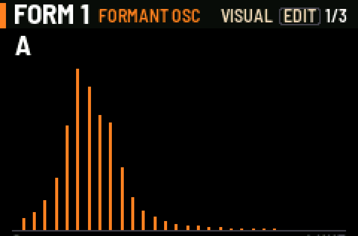 | **FORMANT OSC** A voice-like oscillator: one grain per period, shaped by the vowel's formants. |
| 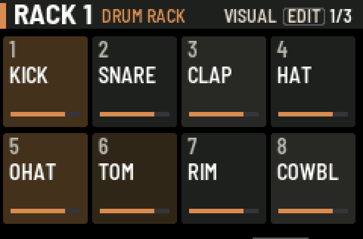 | **DRUM RACK** Eight pads, each a drawn drum (kick, snare, clap, closed hat, open hat, tom, rim, cowbell) or a bank sound, with its own tune, decay and level. T1-T8, ACC and the keys (C to G) strike the pads, and CHOKE lets pads cut each other off. KIT sets all eight pads at once: CUSTOM, the drawn kits BOOM, PUNCH, LO-FI, PERC, GLITCH, METAL, DEEP and TOY, or A, B, C and D (the pads play that bank's sounds 1-8 in order). A PRESET jack steps through the kits. One undo takes a kit change back. |
| 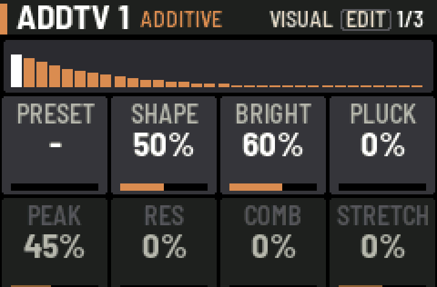 | **ADDITIVE** 32 sine partials shaped by a few controls instead of a filter. SHAPE morphs the spectrum (sine, triangle, saw, square, buzz), BRIGHT is a steep spectral low pass, PEAK and RES make a resonant bump to sweep like a formant, COMB notches move through the partials and STRETCH pulls them apart into bells. A GATE plucks it: BRIGHT opens four octaves and falls back over PLUCK's time. Odd partials lean left and even ones right. |
| 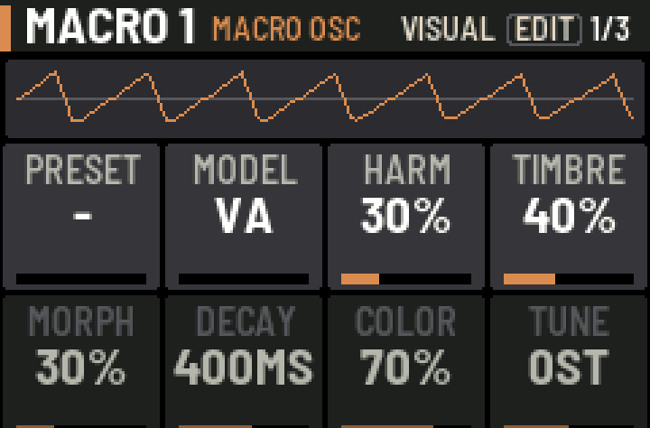 | **MACRO OSC** Eight oscillators in one. HARM, TIMBRE and MORPH mean something in each model and AUX is a variation: VA (two oscillators with detune, saw to square and hard sync), FOLD (sine to triangle through a folder), FM (two operators), FORMANT, CHORD (four saws), SWARM (seven detuned saws), NOISE (a resonant filter at the note) and PARTICLE (random impulses ringing two resonators). The MODEL input picks the model (0.625 V a model). With TRIG patched, its own low pass gate strikes. |
| 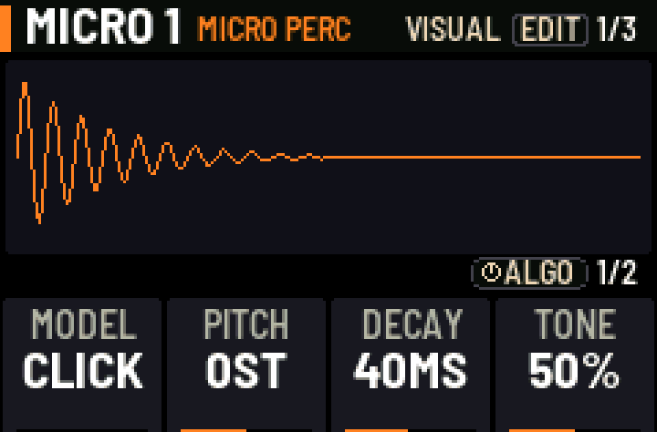 | **MICRO PERC** The small sounds between the drums: CLICK, ZAP, BLIP, TICK, METAL and CRACKLE. TONE sets each one's brightness or depth and SCATTER makes every hit a little different. |
| 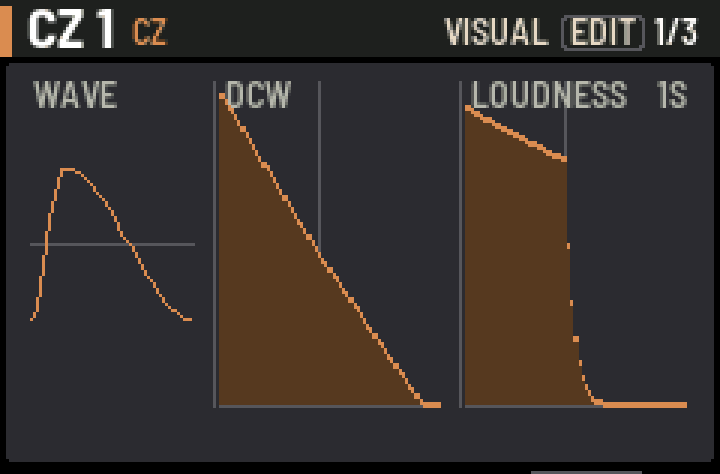 | **CZ** A Casio CZ phase-distortion voice: two lines, each a wave bent by DCW, with the CZ's eight-step pitch, wave and loudness envelopes, vibrato, ring and noise modulation. BANK picks INTERNAL (81 tones, INIT first) or one of four banks of your own and PRESET picks the tone. The other knobs show the tone and moving one changes it (PRESET shows a *). ALGO turns the knob pages. Inputs: V/OCT, GATE and DCW CV. Load CZ-101, CZ-1000, CZ-3000, CZ-5000 or CZ-1 .syx files on the web page (see Sample banks). |
| 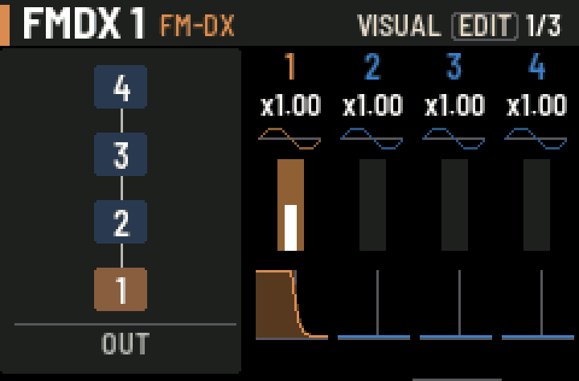 | **FM-DX** A Yamaha TX81Z / DX21 voice: four operators on the YM2414 chip's arithmetic, with the eight TX81Z algorithms, eight waves, the chip's envelopes, frequency ratios, detune and LFO. BANK picks INTERNAL (32 voices, INIT first) or one of four banks of your own and PRESET picks the voice. The knobs show the voice and moving one changes it (PRESET shows a *). Pages: PRESET, VOICE, OP 1-4 (each with an ENV page) and LFO. Inputs: V/OCT, GATE, INDEX (opens or closes the modulators) and FM (into OP 4). Load TX81Z, DX21, DX27 or DX100 .syx files on the web page. |
| 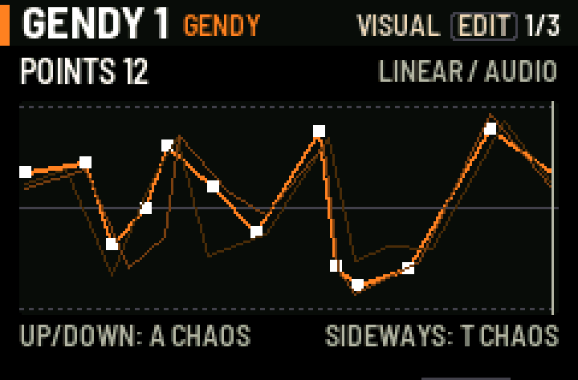 | **GENDY** Xenakis' dynamic stochastic synthesis. One cycle is a ring of POINTS corners (3-16) joined by lines, and every cycle each corner's height (A CHAOS) and time (T CHAOS) take a random step. At 0 it holds one shape, turned up it drifts from a living tone to rough noise. SMOOTH rounds the corners and DIST sets how the steps are drawn. RANGE: AUDIO, LOW or CV. Outputs: OUT and CYCLE (a trigger each cycle, a chaotic clock). |

### Filters and amplifiers

| &nbsp;&nbsp;&nbsp;&nbsp;&nbsp;&nbsp;&nbsp;&nbsp;&nbsp;&nbsp;&nbsp;&nbsp;&nbsp;&nbsp;&nbsp;&nbsp;&nbsp;&nbsp;&nbsp;&nbsp;&nbsp;&nbsp;&nbsp;&nbsp;&nbsp;&nbsp;&nbsp;&nbsp;&nbsp;&nbsp;&nbsp;&nbsp;&nbsp;&nbsp;&nbsp;&nbsp;&nbsp;&nbsp;&nbsp;&nbsp;&nbsp;&nbsp;&nbsp;&nbsp;&nbsp;&nbsp;&nbsp;&nbsp;&nbsp;&nbsp; | |
| --- | --- |
| 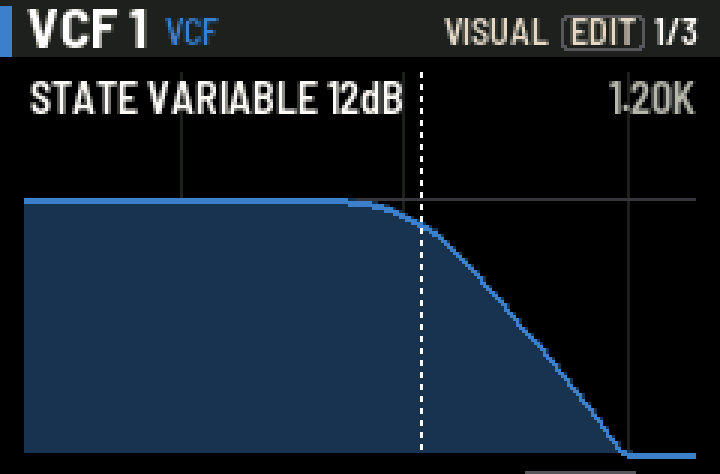 | **VCF** Filter with six circuits (TYPE): state-variable, transistor ladder, diode ladder, OTA 4-pole, OTA 2-pole and Sallen-Key. KEY (a pitch input) moves the cutoff by KEYTRK. |
| 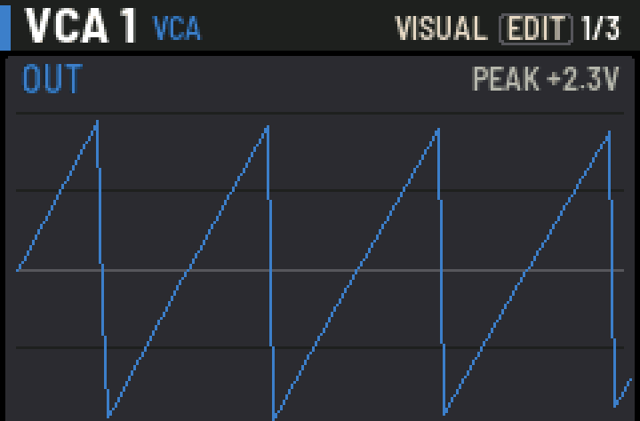 | **VCA** Amplifier. With a CV patched, GAIN sets the maximum. |
| 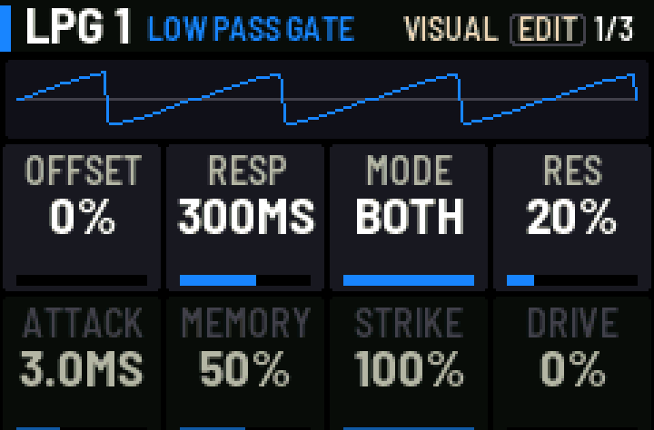 | **LOW PASS GATE** Vactrol low-pass gate. Strike it with PING or open it with CV. Tails ring longer the harder it is played (MEMORY). |
| 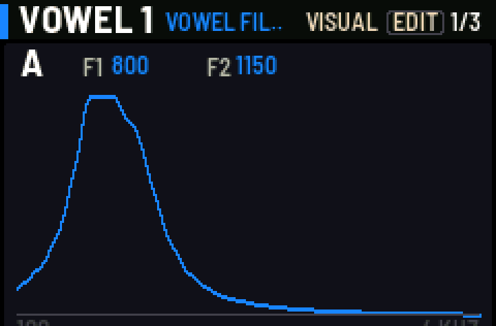 | **VOWEL FILTER** Formant filter that talks A, E, I, O, U. |
| 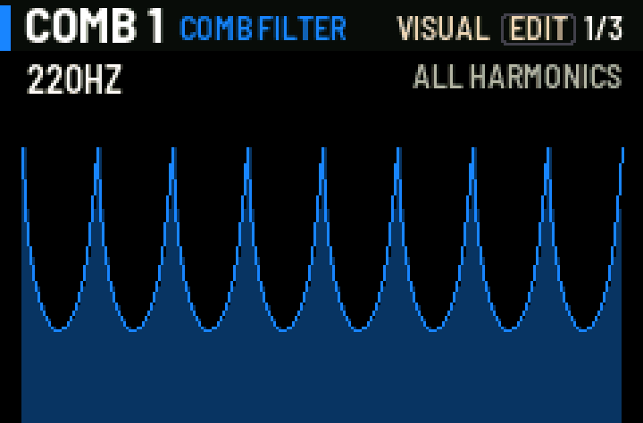 | **COMB FILTER** Resonant peaks at the harmonics of FREQ: metallic, plucked or flanged. |
| 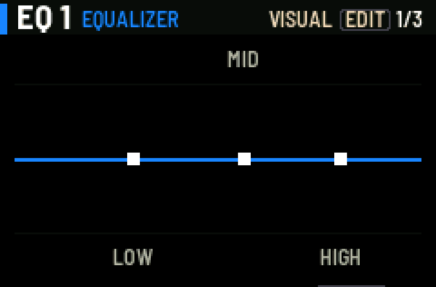 | **EQUALIZER** Three-band EQ: low shelf, sweepable mid bell and high shelf. |

### Effects

| &nbsp;&nbsp;&nbsp;&nbsp;&nbsp;&nbsp;&nbsp;&nbsp;&nbsp;&nbsp;&nbsp;&nbsp;&nbsp;&nbsp;&nbsp;&nbsp;&nbsp;&nbsp;&nbsp;&nbsp;&nbsp;&nbsp;&nbsp;&nbsp;&nbsp;&nbsp;&nbsp;&nbsp;&nbsp;&nbsp;&nbsp;&nbsp;&nbsp;&nbsp;&nbsp;&nbsp;&nbsp;&nbsp;&nbsp;&nbsp;&nbsp;&nbsp;&nbsp;&nbsp;&nbsp;&nbsp;&nbsp;&nbsp;&nbsp;&nbsp; | |
| --- | --- |
| 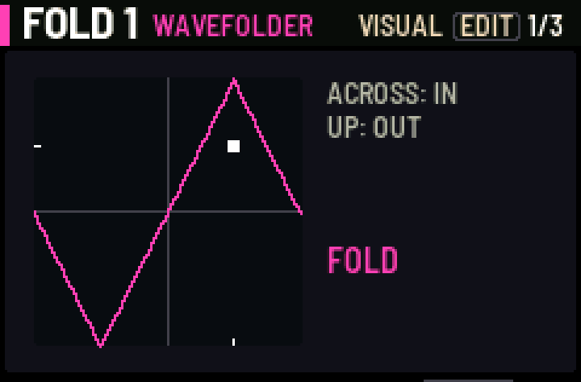 | **WAVEFOLDER** SHAPE picks FOLD (triangle), SINE, CHEBY (a Chebyshev waveshaper, ORDER sets the polynomial) or 259 (five folding stages and a low pass, TONE). FOLD drives the input and BIAS adds even harmonics. |
| 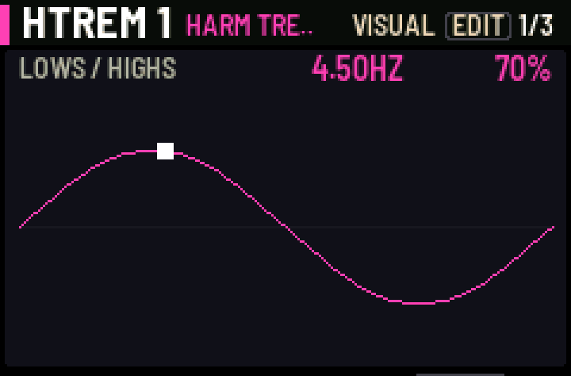 | **HARM TREMOLO** Harmonic tremolo with its own LFO: lows and highs swell in turn (SPLIT is where they part), so a held note swirls instead of pulsing. SYNC sets RATE as a note value. |
| 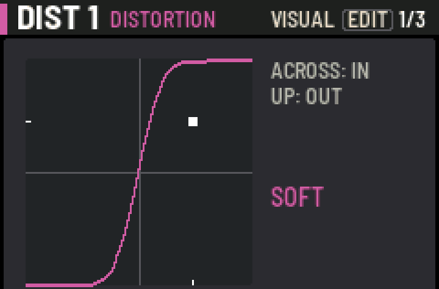 | **DISTORTION** Saturation, clipping, fuzz and bitcrush. |
| 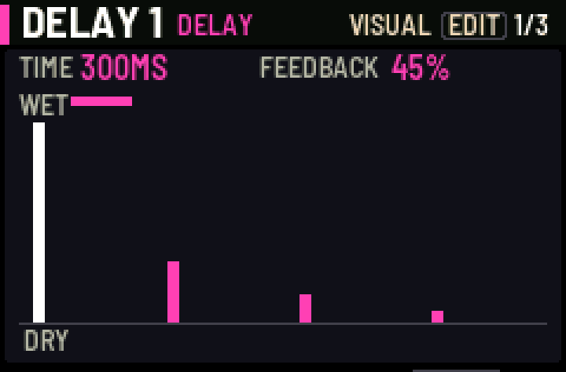 | **DELAY** Echo with filtered, saturating feedback. SYNC to the tempo, TAP (the time between two taps), PING-PONG (L and R), WOBBLE like tape and FREEZE (a knob or gate holds the echo forever). |
| 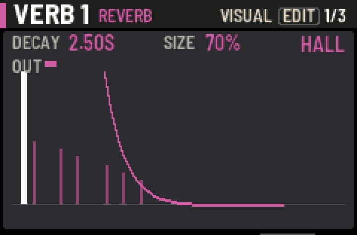 | **REVERB** Stereo reverb in three knob pages: SIZE, DECAY, DAMP, MIX / FREEZE, SHIMMER, SHIM, MODE (ROOM, HALL, PLATE, GATED, SWELL) / PRE-DLY, DIFFUSE, MOD, LOW CUT. FREEZE (knob or gate) holds the tail while you play over it. SHIMMER lets the tail climb in pitch. |
| 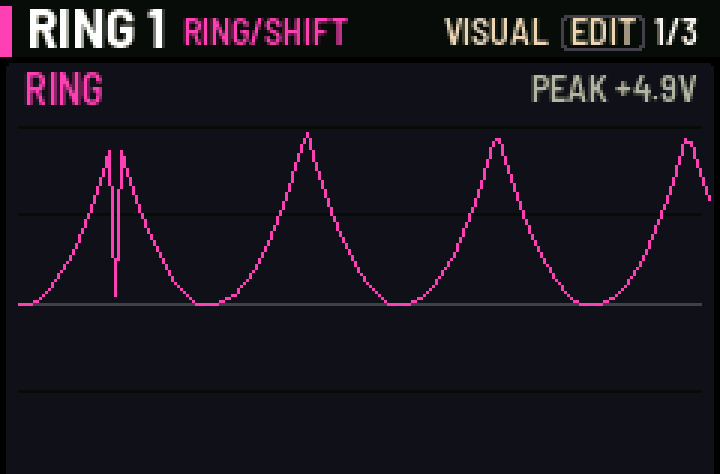 | **RING/SHIFT** Ring modulator and frequency shifter. |
| 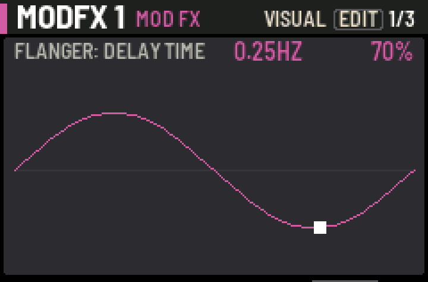 | **MOD FX** TYPE picks FLANGER (a short delay swept by an LFO: FBK, DELAY), PHASER (six all-pass stages: FREQ, FBK) or CHORUS (three slow voices spread left and right: WIDTH). RATE, DEPTH and MIX are shared. SYNC sets RATE as a note value. |
| 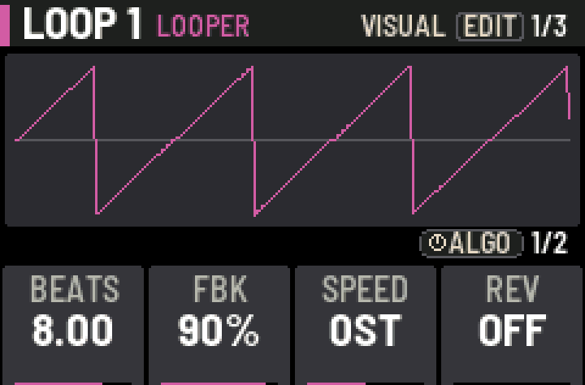 | **LOOPER** Phrase looper. REC layers the input over BEATS (down to 1/8) at the tempo, FBK fades older layers, TONE darkens them, plus SPEED, REV and CLEAR. REC off holds the loop. |
| 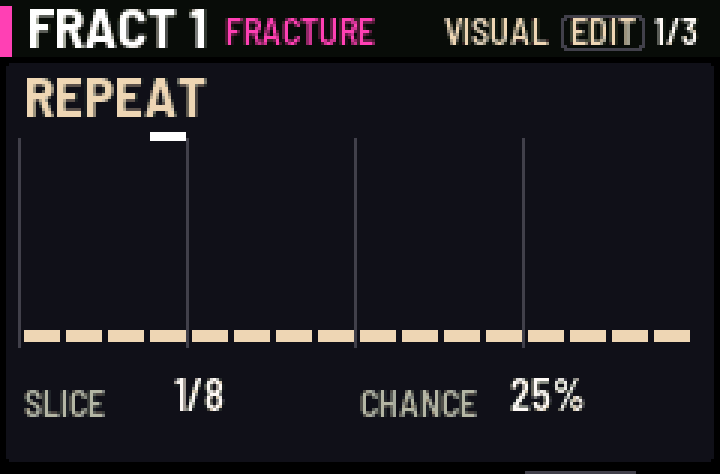 | **FRACTURE** Breaks up the sound. GLITCH repeats slices (SIZE, CHANCE, PITCH), REVERSE plays it backwards (TIME, FBK) and SHUFFLE plays slices from earlier steps, sometimes reversed, an octave up or down or stuttered (DEPTH, OCT, STUTTER, DRY). |
| 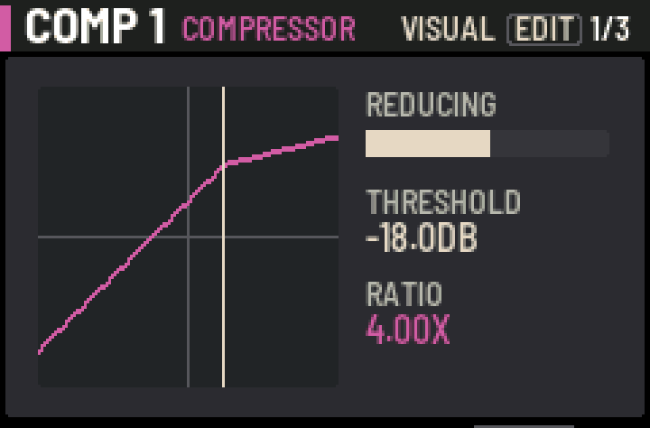 | **COMPRESSOR** Evens out levels. Patch SIDE to duck under another sound. MIX below 100% is parallel compression. |
| 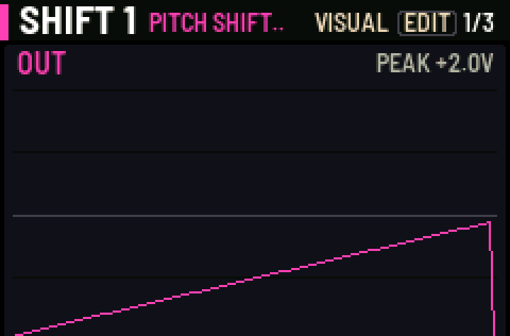 | **PITCH SHIFTER** Moves the sound up or down by SHIFT semitones, keeping its length. |
| 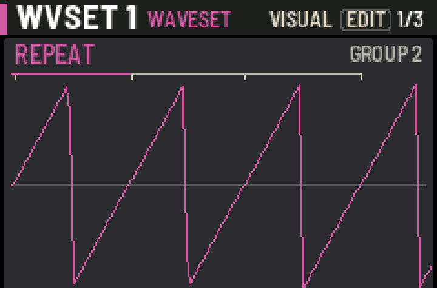 | **WAVESET** Cuts a sound into wavesets (one rising zero crossing to the next) and plays them back rearranged. MODE: REPEAT, REVERSE, OMIT, DIVIDE, FREEZE, SCRAMBLE, AVERAGE, TELESCOPE, INTERP or FRACTAL. AMOUNT is how much (it has a CV jack) and MIX is dry/wet. Best on a single voice such as a bass or mono lead. |
| 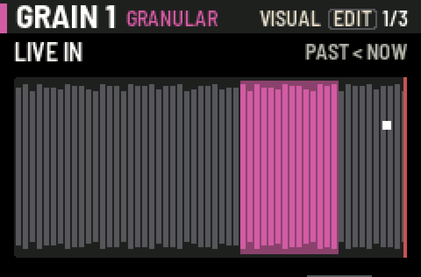 | **GRANULAR** A cloud of short grains from what comes in (the last 0.6 s) or from a bank sound. POS is how far back, with SIZE, DENSITY (or a grain per TRIG), PITCH, DETUNE, SPREAD, WIDTH and FREEZE. |
| 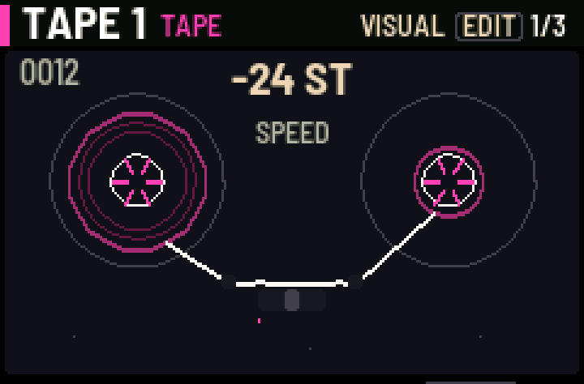 | **TAPE** A tape machine: saturation (DRIVE), WOW, FLUTTER, AGE and HISS. A gate into STOP brakes the tape to a halt. SPEED is varispeed (+-12 semitones, with a 1 V/oct input). |
| 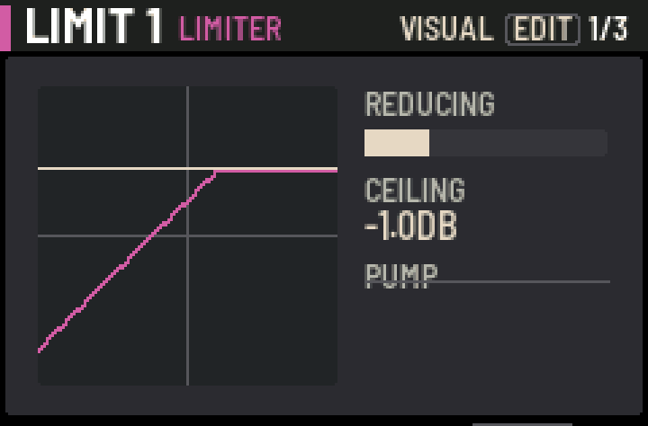 | **LIMITER** Nothing passes CEILING. DRIVE pushes into it. BRICK holds, SOFT rounds and FOLD folds back. PUMP ducks the sound on every beat or on a gate. |
| 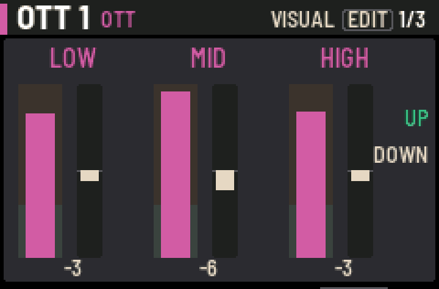 | **OTT** Three-band compression both ways: loud down, quiet up, until it sounds big and close. DEPTH is how much. TIME, SKEW and LOW / MID / HIGH gains shape it. |
| 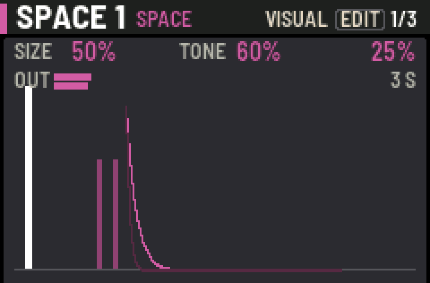 | **SPACE** A small, cheap stereo reverb to use freely: SIZE sets the room and tail together, TONE darkens it, MIX blends. |
| 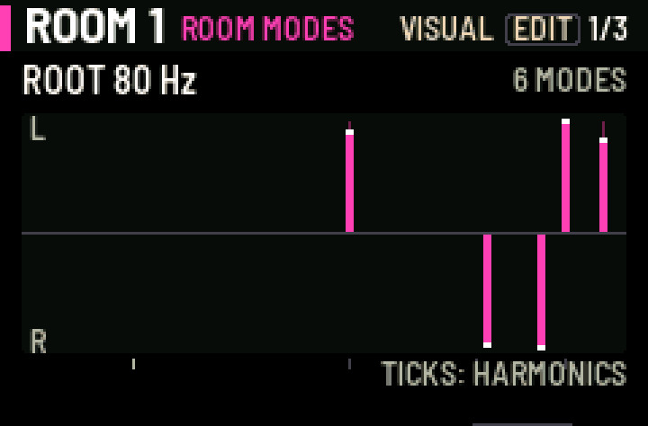 | **ROOM MODES** A room's standing waves: up to eight resonances that are not harmonics, set ringing by whatever comes in. ROOT is the longest wall, SHAPE how far apart the others are, plus MODES, DECAY and MIX. It rings at pitches, so it is not a reverb. |
| 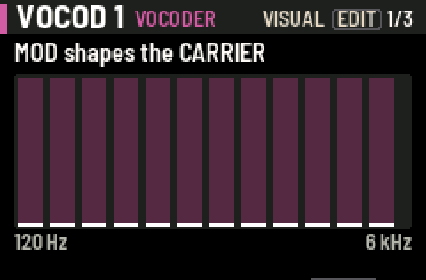 | **VOCODER** Twelve bands from 120 Hz to 6 kHz. MOD (a voice, drums, a sample) shapes CARRIER band by band. With nothing on MOD each band follows its neighbour. SHIFT slides the bands, FOCUS narrows them, BRIGHT tilts the carrier up. Use a saw, pulse, noise or chord as the carrier. |

### Modulators

| &nbsp;&nbsp;&nbsp;&nbsp;&nbsp;&nbsp;&nbsp;&nbsp;&nbsp;&nbsp;&nbsp;&nbsp;&nbsp;&nbsp;&nbsp;&nbsp;&nbsp;&nbsp;&nbsp;&nbsp;&nbsp;&nbsp;&nbsp;&nbsp;&nbsp;&nbsp;&nbsp;&nbsp;&nbsp;&nbsp;&nbsp;&nbsp;&nbsp;&nbsp;&nbsp;&nbsp;&nbsp;&nbsp;&nbsp;&nbsp;&nbsp;&nbsp;&nbsp;&nbsp;&nbsp;&nbsp;&nbsp;&nbsp;&nbsp;&nbsp; | |
| --- | --- |
| 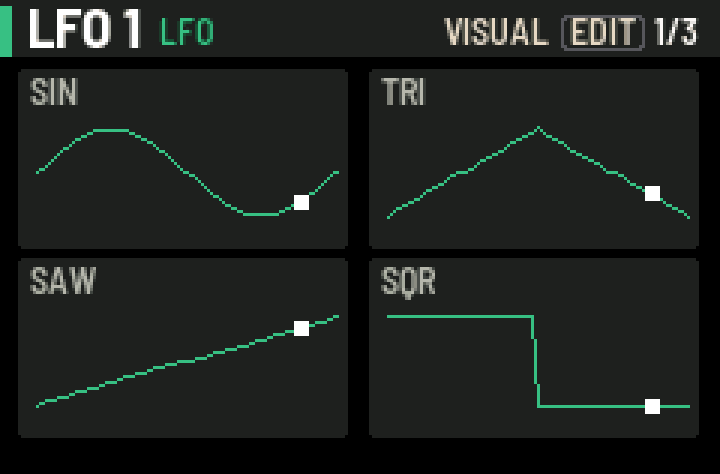 | **LFO** Low-frequency oscillator, 0.01-40 Hz. RATE bends its speed (1 V an octave), DEPTH its level (0-5 V) and RESET restarts it. SYNC sets the rate as a note value of the tempo. |
|  | **ENVELOPE** ADSR, AD or AR envelope. LOOP cycles it like an LFO, CURVE bends each stage, TRIGGER is SOFT, HARD or LEGATO, VEL scales it by key velocity and RANGE is x0.1, normal or x10. |
|  | **FUNCTION** Rise/fall function generator and slew limiter. |
|  | **S&H/RANDOM** Sample and hold, smooth random and random gates. SYNC sets RATE as a note value. |
|  | **SHIFT REG** A CV shift register. Each CLOCK takes IN and shifts every stored value along a register LENGTH (2-16) long. NOW, -1, -2, -3 and END tap the values, and FEEDBK recirculates what falls off the end, so a pattern goes round. MIX crossfades NOW to END and MUTATE nudges what goes in. A sequencer's pitch into IN with END into a second oscillator makes a canon. |
|  | **LISTENER** Plays a melody from a sound. Each onset (a drum hit, a clap, a word) becomes a note chosen from how bright it is, how loud, or its pitch, in a scale. |
|  | **ENV FOLLOWER** Turns a sound's loudness into a voltage. ENV follows it (ATTACK, RELEASE, GAIN), INV is the opposite (to duck another sound) and GATE goes high above THRESH. |
|  | **CHAOS** The Lorenz attractor: three tangled, wandering voltages. |
|  | **MUTATE** A pulse on NUDGE or ROLL shakes the patch, so knobs and steps drift or jump. AMOUNT (with a CV jack) is how far and DENSITY how many knobs. It obeys the locks on the MUTATE page and leaves itself alone. TRIG pulses each time it fires. |
|  | **CV RECORDER** Records a voltage, or its own KNOB, over LENGTH beats and loops it in time. In MODE REC, move the knob (or what is patched into IN) and it records one pass and returns to PLAY. DUB layers a new pass, a gate into REC records while high, SPEED plays at half, double or backwards, SMOOTH rounds it. Each snapshot keeps its own recording. |
|  | **INERTIA** CV with mass: a weight on a spring. MASS, SPRING and FRICTN set how it moves, FORCE the kick of an IMPULSE trigger. MODE FOLLOW pulls it toward the CV, PUSH treats the CV as a force and FLICK kicks it by how fast the CV changes. Outputs POS, VEL and ACC. LFO into INERTIA into a filter turns a rigid sweep into a springy one. |
|  | **PARAM MOD** A voltage moves any knob of any module. Four channels, a page each. Patch a source into CV 1-4, turn MODULE to the module and PARAM to its knob. DEPTH is how far 5 V moves it (negative turns it over) and SMOOTH how slowly it follows. The knob keeps its own value and the voltage is added while the module runs. Up to 16 knobs at once. It is read 2.7 thousand times a second, so fast LFOs on filters and pitch are smooth, but it is not audio-rate FM. |

### Utilities

| &nbsp;&nbsp;&nbsp;&nbsp;&nbsp;&nbsp;&nbsp;&nbsp;&nbsp;&nbsp;&nbsp;&nbsp;&nbsp;&nbsp;&nbsp;&nbsp;&nbsp;&nbsp;&nbsp;&nbsp;&nbsp;&nbsp;&nbsp;&nbsp;&nbsp;&nbsp;&nbsp;&nbsp;&nbsp;&nbsp;&nbsp;&nbsp;&nbsp;&nbsp;&nbsp;&nbsp;&nbsp;&nbsp;&nbsp;&nbsp;&nbsp;&nbsp;&nbsp;&nbsp;&nbsp;&nbsp;&nbsp;&nbsp;&nbsp;&nbsp; | |
| --- | --- |
|  | **ATTENUVERTER** Two attenuverters with offset. CURVE bends and RECT flips or cuts the negative half. |
|  | **CV MIXER** Four bipolar CV inputs plus offset. |
|  | **LOGIC** Gate logic, comparator, MIN, MAX and ABS. |
|  | **COMPARE** Compares A with B plus THRESH and gates when A is over, under, near or has crossed it. MODE: A>B, A<B, WINDOW or CROSS. HYST stops chatter and PULSE turns the gate into triggers. Outputs: GATE, INV and A-B. LOGIC works on gates, COMPARE on levels. |
|  | **SEQ SWITCH** Sequential switch, 4 to 1 and 1 to 4. |
|  | **MIXER** Four channels with level and pan, soft limited. Centered, L alone is a mono mixer. |
|  | **MIXER 8** Eight channels with level and pan, soft limited. |
|  | **PROBABILITY** Each trigger goes on to A, or by CHANCE to B instead. A coin toss. |
|  | **SCOPE** Draws A and B on its page from a rising edge (ZOOM, V/DIV, TRIG). Unpatched, it shows the output under the patch cursor, so one SCOPE is a probe you move with SELECT. MODE SPECTRUM draws the frequencies instead. |
|  | **XFADE** Crossfade. MIX blends A into B by knob and CV (0-5 V is the whole way). EQUAL POWER keeps the loudness steady and LINEAR suits CV. |
|  | **SNAPSHOT** A CV picks the patch's snapshot: 0-5 V is spread over SCENES snapshots (2-16). A clock makes it read only on ticks. Noise through a clock gives a random snapshot every beat, an LFO drifts through them and a MOD SEQ lane writes an arrangement. HYST stops flicking on a boundary, CHANGE waits for the next beat or bar and MORPH glides there. Outputs SCENE and CHANGE. While SONG plays it has the last word. |
|  | **BUTTON** Turns the keys into patchable controls: gate, trigger, toggle, repeat, burst, tap and sample. All 27 keys, no KEYS module needed. Outputs TRIG, HOLD and DBL. GLO+HOME swaps the keys between notes and buttons. |

### Sequencers and clocks

| &nbsp;&nbsp;&nbsp;&nbsp;&nbsp;&nbsp;&nbsp;&nbsp;&nbsp;&nbsp;&nbsp;&nbsp;&nbsp;&nbsp;&nbsp;&nbsp;&nbsp;&nbsp;&nbsp;&nbsp;&nbsp;&nbsp;&nbsp;&nbsp;&nbsp;&nbsp;&nbsp;&nbsp;&nbsp;&nbsp;&nbsp;&nbsp;&nbsp;&nbsp;&nbsp;&nbsp;&nbsp;&nbsp;&nbsp;&nbsp;&nbsp;&nbsp;&nbsp;&nbsp;&nbsp;&nbsp;&nbsp;&nbsp;&nbsp;&nbsp; | |
| --- | --- |
|  | **SEQUENCER** 16 steps of pitch and gate on the lower keys. Each step has ratchets (KNOB 2: x1 to x4), then TIE and GLIDE, with chance and velocity. TIE holds the previous gate through the step. GLIDE does the same and slides the pitch into it. A fast pattern with TIE or GLIDE, a short envelope and a resonant filter is a TB-303. Also swing, divide and length by CV. It sounds the keys as you record. |
|  | **MOD SEQ** Four lanes of 16 steps of voltage out of LANE A-D, to patch anywhere (a filter's FREQ, a delay's TIME, a sampler's SLICE). Each lane has its own length (LEN A-D) so they drift against each other. RANGE, SLEW, CHANCE and direction are shared. TRIG A-D pulse each time a lane steps. |
|  | **CHORD STEPS** A chord progression in a key. Each step is a degree (I-VII), a rest or a tie, with a type and an inversion. Four pitches, a gate and a bass note out. |
|  | **GRAVITY** A bouncing ball plays a tune. Each bounce is the next note, faster and softer until it settles. It drops every few beats or on a trigger. |
|  | **CLOCK** The tempo (SOURCE: the transport or its own TEMPO) out as CLK, DIV, MULT and RST. WARP bends time: over every LENGTH ticks it plays COUNT pulses along a curve (rushing or dragging), with W SWING and DRIFT. RAMP shows where the cycle is and EOC marks its start. |
|  | **QUANTIZER** Pitch quantizer with 12 scales. |
|  | **EUCLID** Euclidean rhythms: HITS spread evenly over STEPS. An unpatched clock follows PLAY. |
|  | **ARPEGGIATOR** Plays the held keys one by one. An unpatched clock uses RATE of the tempo. |
|  | **TURING** A looping random sequence that slowly changes (CHANCE), 2-32 steps long. LOCK (or a gate into it) holds the loop. An unpatched clock follows PLAY. |
|  | **PIANO ROLL** Notes on a grid, with chords of up to four voices on one PITCH, GATE and VEL cable. BARS 1-4 loops. Edit it on the SEQ page: keyboard down the side, SELECT in time, ALGO in pitch, SEL a note and REC records from the keys. GLO+SEQ sets its view (AUTO, FOLD, KEYS). |
|  | **CHORD** One pitch in, a chord of four out, one VCO each. |
|  | **TRIG SEQ** Drum grid: four tracks of 16 steps on the lower keys (OP 1-4 pick track A-D). A key turns its step on or off and GLO + a key steps it through on, accent and roll. Each track has its own length (polymeter), chance and shift. SWING, ROLL and FILL (a gate into FILL: every hit rolls, double time, or extra hits by chance) are on the first page. ACC goes high on every accented hit, patch it to a DRUM SYNTH's ACCENT. |
|  | **GATE DELAY** Two gates or triggers, each later by its TIME (up to 2 s) or a SYNC note value, with their lengths kept. CV A and B add +-1 s. B unpatched is a second tap of A. |
|  | **MARKOV** A melody from chances. Each CLOCK step picks the next note of SCALE: STEP is how much it likes near notes, HOME the pull to the root, fifth and thirds, REPEAT keeps the note and REST silences a step. LEARN: patch a pitch into the LEARN jack and it counts which scale degree followed which. Outputs PITCH, GATE and TRIG. |
|  | **BURST** One trigger makes a rapid series of triggers. COUNT (1-32), SPEED, CURVE (above 0 the gaps shrink like a bouncing ball, below 0 they grow) and JITTER. Outputs TRIG, LEVEL (falls from 5 V to nothing) and PITCH (moves its semitones on every hit). Drum rolls, flams, glitchy fills. |

### Inputs and outputs

| &nbsp;&nbsp;&nbsp;&nbsp;&nbsp;&nbsp;&nbsp;&nbsp;&nbsp;&nbsp;&nbsp;&nbsp;&nbsp;&nbsp;&nbsp;&nbsp;&nbsp;&nbsp;&nbsp;&nbsp;&nbsp;&nbsp;&nbsp;&nbsp;&nbsp;&nbsp;&nbsp;&nbsp;&nbsp;&nbsp;&nbsp;&nbsp;&nbsp;&nbsp;&nbsp;&nbsp;&nbsp;&nbsp;&nbsp;&nbsp;&nbsp;&nbsp;&nbsp;&nbsp;&nbsp;&nbsp;&nbsp;&nbsp;&nbsp;&nbsp; | |
| --- | --- |
|  | **OUTPUT** Main stereo output to the headphones and USB. R follows L when unpatched. LEVEL sets the volume and PROTECT is a brickwall limiter at -0.5 dBFS that stops clipping and is on by default. |
|  | **KEYS** The keys and MIDI notes (USB or TRS, with bend, mod wheel and sustain pedal): pitch, gate, velocity (how hard a key lands, VEL CRV softer or harder) and pressure (leaning into it, PRESS). The twenty keys F3 to C5 sense velocity well and give pressure while held. |
|  | **AUDIO IN** The computer's sound over USB (the 3.5 mm jack is MIDI only). Into a SAMPLER's IN with a gate in REC it records. In the emulator it is the microphone or a browser tab. |
|  | **MIDI IN** Four MIDI CCs as voltages, plus the transport's clock and run. Notes come in through KEYS. |
|  | **MIDI OUT** Plays other gear over USB: notes from PITCH and GATE, two CCs, and MIDI clock with the transport. |

## Sample banks

SAMPLER, GRANULAR and DRUM RACK play sounds from four banks of eight, A to D, kept in the FM-1's flash (about 316 KB for all banks) and sent from the web page over USB. The page's **Presets** buttons load the included banks:

| Bank | Sounds |
| --- | --- |
| A | 808 kit |
| B | 909 kit |
| C | FM drums (from "hizmi - Hybrid Sample Pack 01") |
| D | A mix of odd sounds |

The drum banks run kick, snare, clap, closed hat, open hat, tom, cowbell and crash. The 808 has no crash and the 909 no cowbell, so their rimshot stands in. A DRUM RACK's KIT A, B, C or D plays that bank's sounds 1-8 on its pads.

- **Your own sounds.** Click a slot, or drop up to eight audio files on a bank (they fill it from sound 1 in name order). A SAMPLER's SAMPLE input picks the sound per note (0.3125 V a sound).
- **Trim and Compress.** A slot's Trim box cuts the silence off both ends. Compress packs the sound with SEA at about 3.4 bits a sample, roughly a quarter of the room, and the emulator plays it exactly as the FM-1 will. Turn either off to store the sound whole, as 16-bit.
- **Recording.** AUDIO IN carries the computer's sound (the FM-1 is a USB sound card) into a SAMPLER's IN, and a gate into its REC records it. The 3.5 mm jack is MIDI only.
- **CZ and FM-DX banks.** The CZ and FM-DX modules each have four banks of your own. On the web page, drop .syx files on the CZ banks or FM-DX banks section (CZ-101, CZ-1000, CZ-3000, CZ-5000, CZ-1, TX81Z, DX21, DX27 or DX100, several at once, each its own bank) or on a module's card. A linked FM-1 gets them too.

## Backup

The web page's Backup section downloads one file with the eight user patches, the patch playing, the settings (palette, USER palette, favorites and every row of SETTINGS) and, if you like, the sample banks, from the emulator or from a linked FM-1. Restore puts any of it back on either, and slots the file does not have are left as they are. A single patch also saves and opens as a file of its own (drop it on the patch bay).

## Settings

Press SAVE until you reach SETTINGS. SELECT picks a row, KNOB 1 changes it and HOME leaves. They are kept in the FM-1's flash.

| Setting | |
| --- | --- |
| GLO LATCH | Off: hold GLO while you press the key. On: tap GLO, then the key (GLO shows in the header, and tapping it again cancels) |
| KEY SENSITIVITY | How hard the keys must be hit, for the KEYS VEL output only: OFF, LOW, NORMAL, HIGH |
| AUTO-REPATCH | On: deleting a module reconnects its neighbours. One undo brings it all back |
| EDITS | The default for knob edits: this snapshot only, or all that share the value |
| AUTO COMPACT | On: a big patch shrinks to tags and dots by itself |
| AUTOSAVE | Stores an edited user patch six seconds after you stop (never while playing or holding keys) |
| MIDI CLOCK OUT | On: sends MIDI clock, start and stop over USB while the transport runs, unless a clock comes in |
| PROGRAM CHANGE | SNAPSHOT: program 0-15 picks a snapshot. PATCH: 0-7 load U1-U8 and 8-57 the factory patches |
| PALETTE | HARVEST, MONO, RISO (the default), BONE, GRAPHITE, SOFT, CIRCUIT, MULBERRY, NANO, HAZE, MID, BALANCE, and USER once one is sent from the web page |
| DARKS | LIGHT, NORMAL or DEEP: how deep the dark greys are |
| BRIGHTNESS | 100, 80, 60 or 40 %, dimmed in software |
| CONTROL RATE | FULL, or QUARTER: slow LFOs and envelopes are worked out every fourth sample, for a little less CPU |
| SAMPLE RATE | 44.1 kHz, 22.05 kHz (about half the CPU, duller highs) or AUTO (44.1, dropping to 22.05 when the CPU overloads) |
| DUAL CORE | Experimental: heavy modules run on both cores. Off to start, since some units are less steady with it |
| DIAGNOSTICS | A full-screen page of memory, CPU, battery and what each module costs. HOME leaves |
| FACTORY RESET | SEL twice. Settings only, or settings and the eight user patches. Samples stay |

## Palettes

The FM-1 has twelve built-in palettes: HARVEST, MONO, RISO (the default), BONE, GRAPHITE, SOFT, CIRCUIT, MULBERRY, NANO, HAZE, MID and BALANCE. Pick one in SETTINGS under PALETTE. DARKS and BRIGHTNESS, just below it, set how deep the dark greys are and how bright the screen is.

A thirteenth slot, USER, holds a palette of your own. Make it in the web page's **Screen colors** section: start from any palette, change any of the greys, the text and signal colors or the seven module-group colors, and watch the preview change. Then send it to a linked FM-1 with **Send to FM-1** and it appears as USER in SETTINGS. No firmware build is needed. Saved palettes stay in the browser, and **Share as code** gives you a palette as text to share or paste back in. The page lifts the darks and turns the colors down the way the unit's panel does, so what you see matches the unit. Untick **Match the unit's panel** to see the colors exactly as typed.

